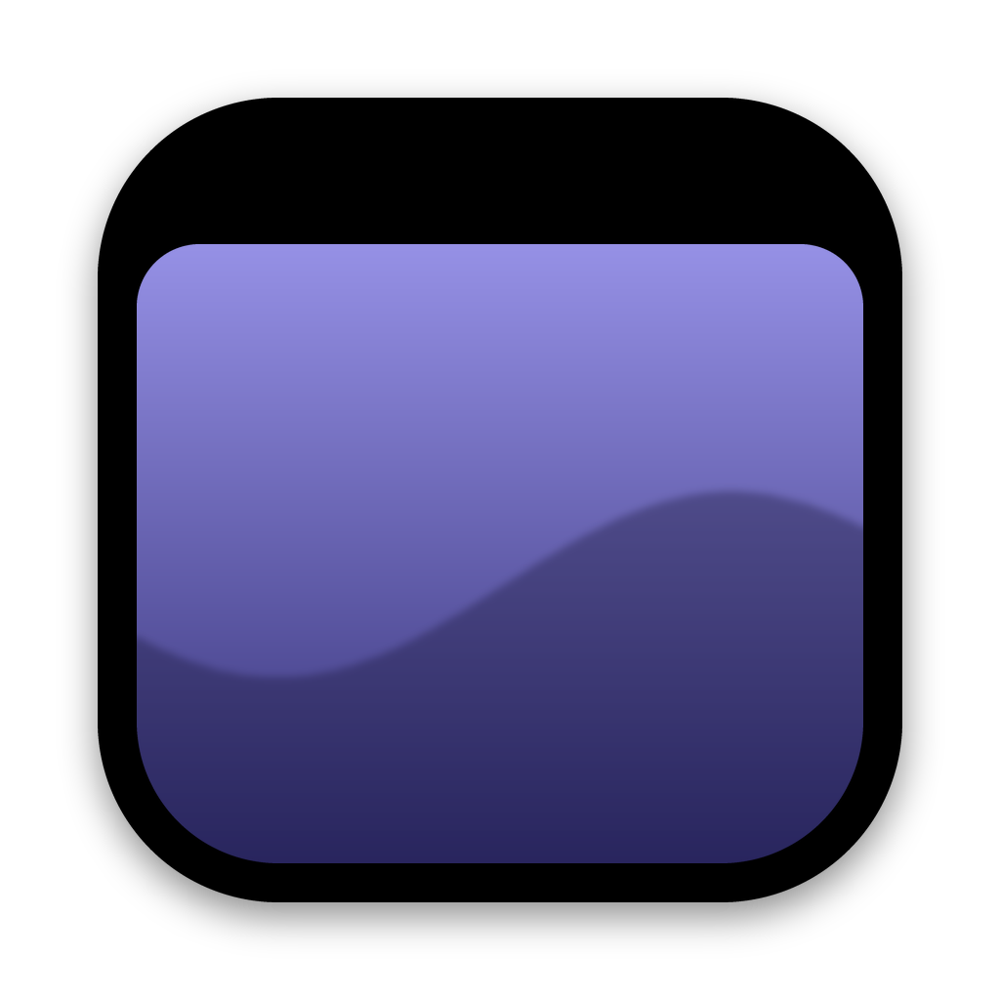
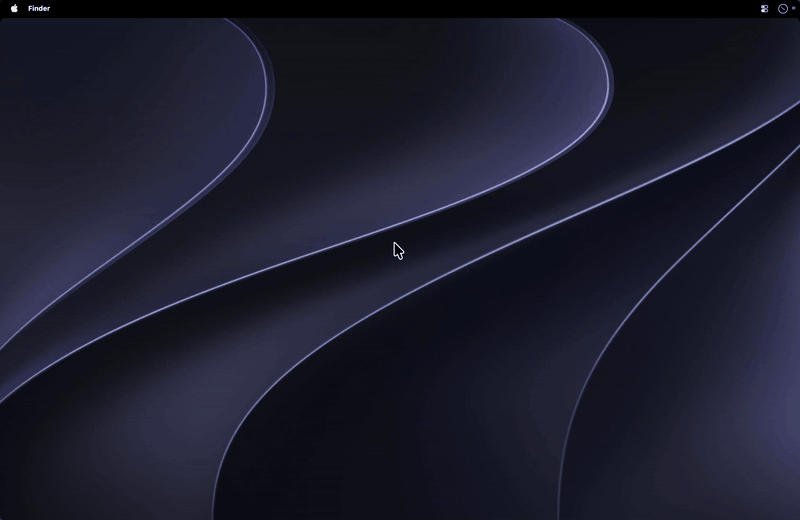

# DarkNotch

Приложение для MacBook с «чёлкой»: делает строку меню полностью чёрной, чтобы вырез
растворился в рамке. Умеет скрывать меню приложений и значки строки меню до наведения
курсора и заменяет менеджеры вроде Bartender, Ice и Thaw на macOS 27 Golden Gate.



## Возможности

- **Чёрная строка меню.** Вырез сливается с чёрной полосой во всю ширину экрана.
- **Скруглённые углы** под строкой меню: Small, Medium или Large.
- **Скрытие меню приложений.** File, Edit, View и остальные меню прячутся, а логотип
  Apple и название приложения остаются. Наведите курсор слева от выреза — меню проявятся.
- **Скрытие значков строки меню.** Значки справа от выреза прячутся, остаются только
  Пункт управления и часы. Наведите курсор справа от выреза, чтобы их показать.
- **Запуск при входе** из меню самого приложения.

Все накладки пропускают клики, поэтому меню и значки работают, даже когда скрыты.
Горячие клавиши и Ctrl+F2 не затрагиваются.

## Требования

- MacBook с вырезом
- Apple silicon
- macOS 13 или новее (проверено на macOS 27 Golden Gate)
- Для сборки из исходников — Command Line Tools (`xcode-select --install`)

## Установка

Скачайте `DarkNotch-<версия>.dmg` из [Releases](../../releases), откройте его и
перетащите **DarkNotch** в папку **Applications**.

Приложение не подписано платным сертификатом Apple, поэтому при первом запуске
macOS покажет предупреждение. Это ожидаемо. Разблокируйте его одним из способов:

1. **Системные настройки (macOS 15 и новее).** Попробуйте открыть приложение,
   закройте предупреждение, затем откройте **Системные настройки → Конфиденциальность
   и безопасность**, прокрутите до раздела **Безопасность** и нажмите **Открыть всё равно**.
2. **Правый клик (macOS 13–14).** В Applications нажмите на DarkNotch правой кнопкой,
   выберите **Открыть** и подтвердите **Открыть** в диалоге.
3. **Терминал.** Уберите карантин и запустите приложение:

   ```sh
   xattr -dr com.apple.quarantine /Applications/DarkNotch.app
   open /Applications/DarkNotch.app
   ```

Подробная инструкция лежит внутри DMG в файле `README.txt`.

### Разрешение Accessibility

Пункты **Hide App Menus** и **Hide Menu Bar Icons** используют Accessibility, чтобы
точно находить меню, Пункт управления и часы. Без разрешения приложение оценивает их
положение приблизительно.

Включите DarkNotch в **Системные настройки → Конфиденциальность и безопасность →
Универсальный доступ**.

## Использование

Нажмите на иконку в строке меню:

| Пункт | Что делает |
| --- | --- |
| Hide Notch | Включает и выключает чёрную строку меню |
| Round Corners | Off, Small, Medium или Large |
| Hide App Menus | Прячет меню приложений до наведения слева от выреза |
| Hide Menu Bar Icons | Прячет значки, кроме Пункта управления и часов, до наведения справа |
| Fade Menu Bar in Full Screen | Затемняет строку меню в полноэкранных приложениях |
| Accessibility | Показывает состояние разрешения; нажмите, чтобы исправить |
| Launch at Login | Запускает DarkNotch при входе. Приложение должно лежать в `/Applications` |
| Quit DarkNotch | Завершает работу |

## Как это работает

- **Чёрная полоса.** Приложение сохраняет копию обоев с чёрной полосой высотой со
  строку меню и ставит копию как обои. macOS рисует строку меню на чёрном фоне и
  переключает текст на белый. Оригинальные обои не изменяются, а при выключении
  Hide Notch возвращаются на место.
- **Углы и накладки.** Это небольшие окна без рамки поверх строки меню. Они не
  перехватывают клики, видны на всех рабочих столах и скрываются в полноэкранном режиме.

## Известные ограничения

- **Динамические обои становятся статичной картинкой**, пока включён Hide Notch.
  Некоторые встроенные обои macOS, включая Golden Gate, рисуются системой и не могут
  быть прочитаны как изображение. Используйте обычный файл изображения.
- **Краткий вырез на экране блокировки.** Приложения не могут рисовать там, поэтому
  вырез на мгновение виден на экране блокировки и входа.
- **Запись экрана может скрыть название приложения.** Если рекордер исключает себя
  из записи, владея строкой меню, его название и меню исчезают из видео.

## Сборка из исходников

```sh
git clone https://github.com/zheltukheen/darknotch_on_golden_gate.git
cd darknotch_on_golden_gate
./scripts/build.sh          # dist/DarkNotch.app
./scripts/make-dmg.sh       # dist/DarkNotch-1.0.0.dmg
```

Для DMG нужен Python 3 и пакет [dmgbuild](https://github.com/dmgbuild/dmgbuild);
`make-dmg.sh` создаст виртуальное окружение и установит его сам.

Проверка сборки, подписи и содержимого DMG:

```sh
./scripts/test.sh
```

## Релизы

Релиз собирается автоматически на GitHub Actions при пуше тега `v*`:

```sh
git tag v1.0.1
git push origin v1.0.1
```

Workflow собирает приложение, подписывает его ad-hoc, создаёт стилизованный DMG,
проверяет его и прикрепляет файл к GitHub Release. Версия берётся из тега.
Ручной запуск — вкладка **Actions → Release → Run workflow**.

## Структура проекта

```
Sources/DarkNotch/main.swift   исходный код приложения
Resources/                     иконка и оформление DMG
packaging/                     Info.plist и настройки dmgbuild
scripts/                       сборка, упаковка, проверка, генерация графики
.github/workflows/release.yml  автоматический релиз
```

## Удаление

1. Выберите **Quit DarkNotch** в меню приложения. Если хотите вернуть обои,
   сначала выключите Hide Notch.
2. Удалите `/Applications/DarkNotch.app`.
3. При желании удалите данные:

   ```sh
   rm -rf ~/Library/Application\ Support/DarkNotch
   defaults delete com.zheltukheen.darknotch
   ```

## Лицензия

[MIT](LICENSE). DarkNotch не связан с Apple.
